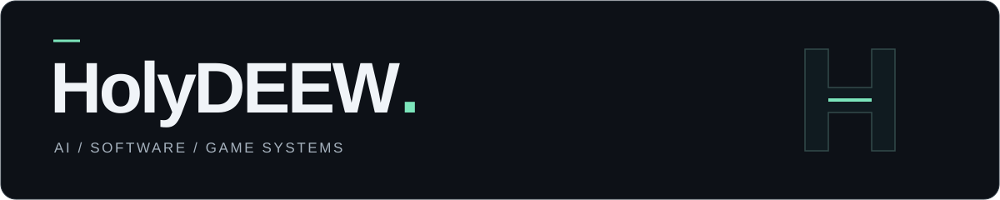
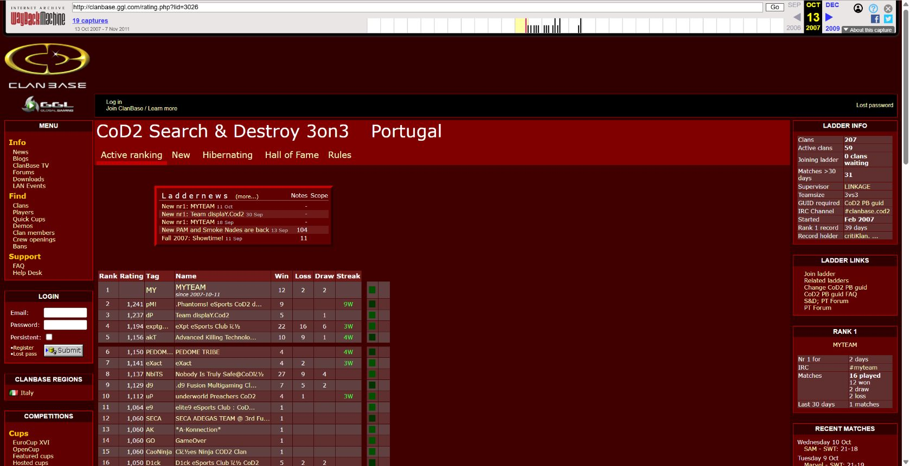
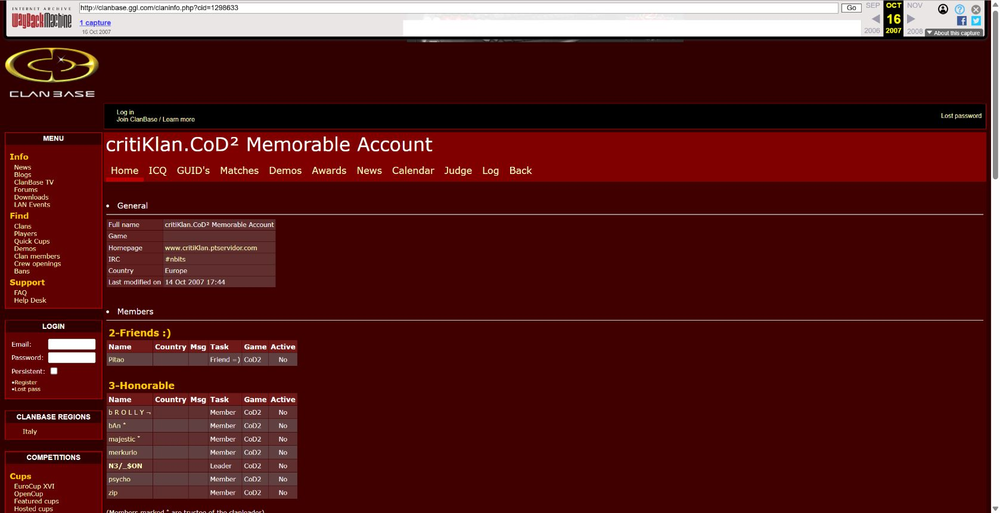

  

I'm **Nelson**, known online as **HolyDEEW**, an independent developer from Portugal. I build AI agents, web products and game systems, with a background in MMORPG emulation and reverse engineering.

**Founder & main developer · [WoWHellgarve](https://wowhellgarve.com/)** 
**Developer · [SPP — Single Player Project](https://discord.com/invite/single-player-project-291115666097045506)** 
**Creator & developer · [HXARK](https://hxark.com/)**

### Current focus — HXARK

**[HXARK](https://hxark.com/)** is my AI agent platform for business tasks: research, content with images, documents, reports and scheduled workflows. Agents work in the cloud or through an optional Chrome extension, with activity and results visible in the conversation.

The web product is open to the public. It brings together connected accounts, browser actions and recurring tasks, so a request can become work someone can review and use.

[Try HXARK](https://hxark.com/) · [See real demonstrations](https://hxark.com/demonstracoes/)

### Products I build

<table>
<tr>
<td width="50%" valign="top">
<h3><a href="https://ihostnexus.com/">iHostNexus</a></h3>

<strong>Founder & developer · Web platform</strong>

Property operations, check-ins, keys, owners and teams, alongside online bookings and private service contracts. I build and maintain the platform, from backend workflows to the screens people use.

</td>
<td width="50%" valign="top">
<h3><a href="https://hellshooter.com/">Hell-Shooter</a></h3>

<strong>Creator & developer · Public Windows beta</strong>

A 2D multiplayer shooter with tactical bots, destructible cover, progression and its own launcher. Available for Windows through the Microsoft Store or the standalone installer.

</td>
</tr>
</table>

### Open-source tools & research

| Project | What I built |
| :--- | :--- |
| **[HXARK Sniffer](https://github.com/WoWHellgarve-HolyDeeW/HXARK-Sniffer)** | A Windows tool for WoW Retail packet capture, with automatic network-interface detection and PKT output for WowPacketParser. **Beta**, with build-specific compatibility. |
| **[RoK Stats Hub](https://github.com/WoWHellgarve-HolyDeeW/Rok-stats-titlebot)** | Rise of Kingdoms runtime instrumentation, scanners and title-management tooling, plus a FastAPI / Next.js dashboard and published protocol research. |
| **[HolyConnect](https://github.com/WoWHellgarve-HolyDeeW/holyconnect)** | USB networking between Windows and Pi-Star / MMDVM hotspots: Raspberry Pi setup, RNDIS, internet sharing and diagnostics for hardware with failed Wi-Fi. |
| **[mod-multi-vendor](https://github.com/WoWHellgarve-HolyDeeW/mod-multi-vendor)** | A C++ / SQL multi-vendor module for AzerothCore and WoWHellgarve WotLK, with shop lists managed through the database. |

### WoWHellgarve & SPP

I founded **[WoWHellgarve](https://wowhellgarve.com/)** and remain its **main developer**. My work spans WoW server emulation, custom gameplay systems, databases, launchers, crash investigation and the daily work of keeping a live community running.

I'm also a **developer on SPP — Single Player Project**, working on server behaviour, debugging, fixes and local builds. My work includes **[KyrianCORE / Shadowlands](https://github.com/coolzoom/KyrianCORE-OpenSource)**.

I started at 16 with Lineage II private servers. That grew into years of emulator development, runtime instrumentation, memory analysis and protocol research. The tools above are part of turning that work into something others can inspect and use.

### Open-source contributions

- **AMALIA / European Portuguese AI:** submitted fixes for [API examples](https://github.com/AMALIA-LLM/AMALIA/pull/4), [evaluation checkpoint filters](https://github.com/AMALIA-LLM/amalia-lm-eval/pull/5), [result-table output paths](https://github.com/AMALIA-LLM/amalia-lm-eval/pull/4) and [WARC processing cleanup](https://github.com/AMALIA-LLM/arquivo_processing/pull/2). These pull requests are open; the projects are maintained by AMALIA-LLM.
- **AzerothCore:** merged work on [detailed logging](https://github.com/azerothcore/mod-detailed-logging/pull/10), [NPC services](https://github.com/azerothcore/mod-npc-services/pull/22) and [premium module compatibility](https://github.com/azerothcore/mod-premium-lib/pull/6).
- **Earlier contributions as @holydeew:** merged anticheat adjustments for [Alterac Valley — Alliance](https://github.com/azerothcore/mod-anticheat/pull/97), [Alterac Valley — Horde](https://github.com/azerothcore/mod-anticheat/pull/98) and [Warsong Gulch](https://github.com/azerothcore/mod-anticheat/pull/99), plus a [Portuguese README](https://github.com/azerothcore/mod-anticheat/pull/96).

### Other work

- **[Guardião SOS](https://guardiaosos.com/)** — an experimental Android safety app exploring on-device detection of possible falls and road accidents, with a cancellable countdown before an SOS message. **In development / testing; not yet publicly released on Google Play.**
- **[Kayak Adventures Lagos](https://kayakadventureslagos.com/)** · [code](https://github.com/WoWHellgarve-HolyDeeW/kayakadventureslagos) — website development for a local tourism business.
- **[COPS Salary Calculator](https://github.com/WoWHellgarve-HolyDeeW/Cops-Salario-Calculador)** — an earlier Windows / Android utility for estimating monthly pay, published in 2024.

### Tools I work with

**Code** · C++ · C# · Python · TypeScript · JavaScript · PHP · PowerShell 
**Web & data** · Next.js · Node.js · FastAPI · MySQL · PostgreSQL · Redis 
**Systems & research** · Linux · Windows Server · Docker · Frida · AzerothCore · TrinityCore

<strong>ClanBase days — CritiKlan & competitive gaming</strong>

 

I led **CritiKlan** in Call of Duty 2 as **N3/_$ON**. Our [August 2007 team announcement](https://web.archive.org/web/20070830031822/http://www.critiklan.ptservidor.com:80/index.php) and [ClanBase roster](https://web.archive.org/web/20071016125410/http://clanbase.ggl.com:80/claninfo.php?cid=1298633) still carry that name.

We reached **#1 in Portugal's CoD2 Search & Destroy 3on3 ladder**. The [ClanBase snapshot from 13 October 2007](https://web.archive.org/web/20071013070313/http://clanbase.ggl.com:80/rating.php?lid=3026) lists critiKlan as the record holder for time at #1: **39 days**.

[Team news and the July 2007 report of reaching #1](https://web.archive.org/web/20070830031822/http://www.critiklan.ptservidor.com:80/index.php) · [Spring OpenCup team](https://web.archive.org/web/20070628230900/http://critiklan.ptservidor.com:80/) · [Iberian Cup registration](https://cod2.gamersmafia.com/noticias/23011)

<strong>Earlier work & background</strong>

 

My Lineage II work included networking, account panels, rankings, databases and community support. [L2Hellgarve's 2018 archive](https://web.archive.org/web/20180401122354/http://www.l2hellgarve.com/) is one surviving record of that work.

More of my older work lives on [@holydeew](https://github.com/holydeew), including [a fork of TrinityCore custom changes](https://github.com/holydeew/TrinityCoreCustomChanges) and [WoWHellgarve Legion](https://github.com/holydeew/WoWHellgarve-Legion). I've also worked on Android experiments, including OctuposAI, which was previously published on Google Play.

This account also holds forks of emulator projects and AzerothCore modules I've worked with over the years. They sit alongside my own tools and projects.

Outside software, Hellgarve was also part of my music background. There's an [old article about Holydeew, Hellgarve and FNAC Faro](https://amusicaportuguesa.blogs.sapo.pt/hip-hop-na-fnac-faro-com-hellgarve-2197770).

---

[HXARK](https://hxark.com/) · [WoWHellgarve](https://wowhellgarve.com/) · [SPP community](https://discord.com/invite/single-player-project-291115666097045506) · [YouTube](https://www.youtube.com/@wowhellgarve) · [Earlier GitHub](https://github.com/holydeew)

